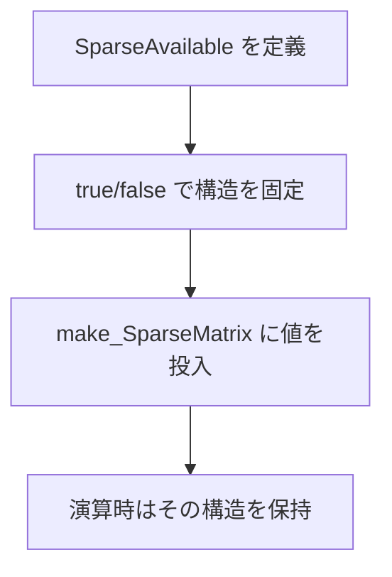

# 02. 行列の定義と生成（Dense/Diag/Sparse）

`sample/arithmetic_operation.cpp` を中心に、`python_numpy` の基本的な行列実装方法を整理します。

## 2.1 3種類の行列

| 種類 | 生成 API | 代表型エイリアス |
|---|---|---|
| Dense（通常の2次元行列） | `make_DenseMatrix<M,N>(...)` | `DenseMatrix_Type<T,M,N>` |
| Diag（対角行列） | `make_DiagMatrix<M>(...)` | `DiagMatrix_Type<T,M>` |
| Sparse（疎行列） | `make_SparseMatrix<SparseAvailable>(...)` | `SparseMatrix_Type<T,SparseAvailable>` |

---

## 2.2 Dense 行列

```cpp
auto A = make_DenseMatrix<3, 3>(
  1.0, 2.0, 3.0,
  5.0, 4.0, 6.0,
  9.0, 8.0, 7.0
);

DenseMatrix_Type<double, 3, 3> A_t = A;
```

- テンプレート引数 `<3,3>` は行数・列数（コンパイル時確定）
- 値は行優先で渡します

---

## 2.3 Diag 行列

```cpp
auto B = make_DiagMatrix<3>(1.0, 2.0, 3.0);
DiagMatrix_Type<double, 3> B_t = B;
```

- 非対角成分は 0 として扱われます
- `create_dense()` で Dense 化して表示可能です

---

## 2.4 Sparse 行列（実装の要点）

疎行列では、まず「どの要素が存在するか」を型で定義します。

```cpp
using SparseAvailable_C = SparseAvailable<
  ColumnAvailable<true,  false, false>,
  ColumnAvailable<true,  false, true>,
  ColumnAvailable<false, true,  true>
>;

auto C = make_SparseMatrix<SparseAvailable_C>(1.0, 3.0, 8.0, 2.0, 4.0);
SparseMatrix_Type<double, SparseAvailable_C> C_t = C;
```

### 読み方

- `true`: その位置に値を保持する
- `false`: その位置は構造的に 0
- `make_SparseMatrix` の引数には、`true` の個数分だけ値を渡す



---

## 2.5 初期化ユーティリティ

`sample/arithmetic_operation.cpp` で使われている代表例:

| API | 用途 |
|---|---|
| `make_DenseMatrixZeros<T,M,N>()` | Dense 全要素 0 |
| `make_DenseMatrixOnes<T,M,N>()` | Dense 全要素 1 |
| `make_DenseMatrixFull<M,N>(value)` | Dense 全要素を任意値 |
| `make_DiagMatrixZeros<T,M>()` | Diag の対角を 0 |
| `make_DiagMatrixIdentity<T,M>()` | 単位行列 |
| `make_DiagMatrixFull<M>(value)` | Diag の対角を任意値 |
| `make_SparseMatrixEmpty<T,M,N>()` | 構造空の Sparse |
| `make_SparseMatrixZeros<T,SparseAvailable>()` | Sparse の保持要素を 0 |
| `make_SparseMatrixOnes<T,SparseAvailable>()` | Sparse の保持要素を 1 |
| `make_SparseMatrixFull<SparseAvailable>(value)` | Sparse の保持要素を任意値 |

---

## 2.6 配列から Dense を作る

```cpp
std::array<std::array<double, 3>, 3> array_input = {
  {{1.0, 2.0, 3.0}, {4.0, 5.0, 6.0}, {7.0, 8.0, 9.0}}
};

auto row_major = make_DenseMatrix_from_row_major(array_input);
auto col_major = make_DenseMatrix_from_col_major(array_input);
```

NumPy の `order='C'`（行優先）/`order='F'`（列優先）に相当する入力方向を切り替えできます。

