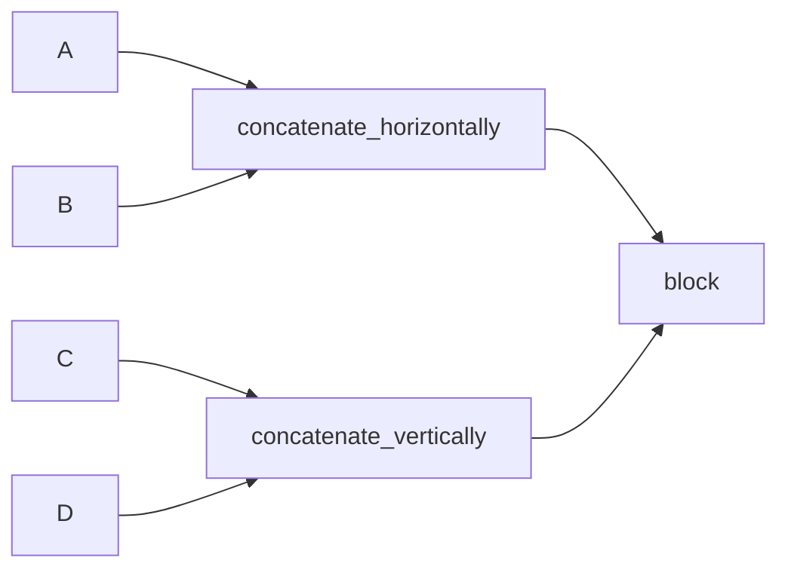

# 03. 行列操作（積・転置・連結・reshape・置換・ノルム）

この章では、`sample/arithmetic_operation.cpp` / `sample/concatenation.cpp` / `sample/matrix_action.cpp` の使い方をまとめます。

## 3.1 基本演算と表示

```cpp
auto result = A * C;

for (size_t i = 0; i < result.rows(); ++i) {
  for (size_t j = 0; j < result.cols(); ++j) {
    std::cout << result(i, j) << " ";
  }
}
```

- `rows()`, `cols()` でサイズ取得
- `operator()(row, col)` で要素アクセス

---

## 3.2 転置系 API

`sample/arithmetic_operation.cpp` で使う3パターン:

| API | NumPy 対応 |
|---|---|
| `A.transpose()` | `A.T` |
| `ATranspose_mul_B(A, C)` | `A.T @ C` |
| `A_mul_BTranspose(A, C)` | `A @ C.T` |

---

## 3.3 連結（縦・横・ブロック・タイル）

### 縦連結 / 横連結

```cpp
auto vertical = concatenate_vertically(A, C);
auto horizontal = concatenate_horizontally(A, B);
```

更新版 API:

```cpp
update_horizontally_concatenated_matrix(horizontal, A, 2.0 * B);
```

### ブロック連結

```cpp
constexpr std::size_t BLOCK_ROW_SIZE = 2;
constexpr std::size_t BLOCK_COLUMN_SIZE = 2;

auto ABCE = concatenate_block<BLOCK_ROW_SIZE, BLOCK_COLUMN_SIZE>(A, B, C, E);
update_block_concatenated_matrix<BLOCK_ROW_SIZE, BLOCK_COLUMN_SIZE>(
  ABCE, A, 2.0 * B, C, E
);
```

### タイル連結

```cpp
auto C_Tile = concatenate_tile<2, 3>(C);
```



---

## 3.4 reshape と更新

`sample/matrix_action.cpp`:

```cpp
auto B = reshape<8, 2>(A);
update_reshaped_matrix(B, A);
```

- 要素数一致が前提（コンパイル時チェック）
- 形状だけ変えてデータを再配置

---

## 3.5 置換（substitute）

### 同サイズ置換

```cpp
substitute_matrix(C, A_s);
```

### 部分行列置換

```cpp
substitute_part_matrix<1, 1>(A, C);
```

- `<1,1>` は埋め込み先のオフセット（行, 列）

---

## 3.6 ノルム・要素ごとの積

```cpp
auto C_norm = norm(C);
element_wise_multiply(E, C_dense, D);
```

NumPy 対応:

- `norm(C)` ↔ `np.linalg.norm(C)`
- `element_wise_multiply(E, X, Y)` ↔ `E = X * Y`

---

## 3.7 AugmentedMatrix（ブロック行列）

`sample/augmented_matrix.cpp` では、行列をタプル化して拡張行列を組み立てます。

```cpp
using AA_Tuple_Type = AugmentedMatrix_Tuple_Type<A_Type, A_Type, A_Type, A_Type>;

auto AA = make_AugmentedMatrixZeros<AA_Tuple_Type>();
auto AB = make_AugmentedMatrix(A, A, A, A);
auto C = AA * AB;
```

可変長のブロック行列を「型として固定」して扱いたいときのパターンです。

