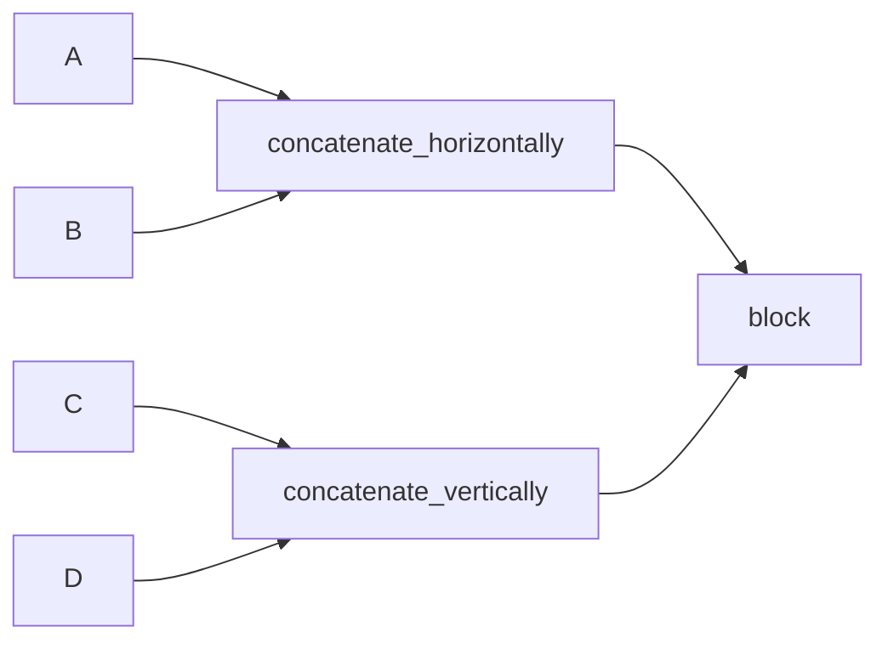

# 03. 行列操作（積・転置・連結・reshape・置換・ノルム）

この章では、`sample/arithmetic_operation.cpp` / `sample/concatenation.cpp` / `sample/matrix_action.cpp` / `sample/trigonometric.cpp` / `sample/convolve.cpp` の使い方をまとめます。

## 3.1 基本演算と表示

```cpp
auto result = A * C;

for (size_t i = 0; i < result.rows(); ++i) {
  for (size_t j = 0; j < result.cols(); ++j) {
    std::cout << result(i, j) << " ";
  }
}
```

- `rows()`, `cols()` でサイズ取得
- `operator()(row, col)` で要素アクセス

---

## 3.2 転置系 API

`sample/arithmetic_operation.cpp` で使う3パターン:

| API | NumPy 対応 |
|---|---|
| `A.transpose()` | `A.T` |
| `ATranspose_mul_B(A, C)` | `A.T @ C` |
| `A_mul_BTranspose(A, C)` | `A @ C.T` |

---

## 3.3 連結（縦・横・ブロック・タイル）

### 縦連結 / 横連結

```cpp
auto vertical = concatenate_vertically(A, C);
auto horizontal = concatenate_horizontally(A, B);
```

更新版 API:

```cpp
update_horizontally_concatenated_matrix(horizontal, A, 2.0 * B);
```

### ブロック連結

```cpp
constexpr std::size_t BLOCK_ROW_SIZE = 2;
constexpr std::size_t BLOCK_COLUMN_SIZE = 2;

auto ABCE = concatenate_block<BLOCK_ROW_SIZE, BLOCK_COLUMN_SIZE>(A, B, C, E);
update_block_concatenated_matrix<BLOCK_ROW_SIZE, BLOCK_COLUMN_SIZE>(
  ABCE, A, 2.0 * B, C, E
);
```

### タイル連結

```cpp
auto C_Tile = concatenate_tile<2, 3>(C);
```



---

## 3.4 reshape と更新

`sample/matrix_action.cpp`:

```cpp
auto B = reshape<8, 2>(A);
update_reshaped_matrix(B, A);
```

- 要素数一致が前提（コンパイル時チェック）
- 形状だけ変えてデータを再配置

---

## 3.5 置換（substitute）

### 同サイズ置換

```cpp
substitute_matrix(C, A_s);
```

### 部分行列置換

```cpp
substitute_part_matrix<1, 1>(A, C);
```

- `<1,1>` は埋め込み先のオフセット（行, 列）

---

## 3.6 ノルム・要素ごとの積

```cpp
auto C_norm = norm(C);
element_wise_multiply(E, C_dense, D);
```

NumPy 対応:

- `norm(C)` ↔ `np.linalg.norm(C)`
- `element_wise_multiply(E, X, Y)` ↔ `E = X * Y`

---

## 3.7 AugmentedMatrix（ブロック行列）

`sample/augmented_matrix.cpp` では、行列をタプル化して拡張行列を組み立てます。

```cpp
using AA_Tuple_Type = AugmentedMatrix_Tuple_Type<A_Type, A_Type, A_Type, A_Type>;

auto AA = make_AugmentedMatrixZeros<AA_Tuple_Type>();
auto AB = make_AugmentedMatrix(A, A, A, A);
auto C = AA * AB;
```

可変長のブロック行列を「型として固定」して扱いたいときのパターンです。

---

## 3.8 行列を引数にした数学関数（`sample/trigonometric.cpp`）

`python_numpy` では、数学関数を **スカラーだけでなく行列全体に適用**できます。
`sample/trigonometric.cpp` は、その使い方を示すサンプルです。

```cpp
auto time = PythonNumpy::make_DenseMatrix<11, 1>(
  0.0, 0.1, 0.2, 0.3, 0.4, 0.5, 0.6, 0.7, 0.8, 0.9, 1.0
);

auto series_data = PythonNumpy::sin(2.0 * PythonNumpy::PI * time);
```

この例でユーザーが押さえるべき点は次の 2 つです。

1. `time` が行列でも、`sin(...)` をそのまま呼べる
2. 関数は要素ごとに適用され、戻り値も同じ形状の行列になる

NumPy との対応は直感的で、次と同じ発想で記述できます。

- NumPy: `np.sin(2 * np.pi * time)`
- C++: `sin(2.0 * PI * time)`

`sin` 以外にも同様の行列引数 API が用意されています（例: `cos`, `tan`, `exp`, `sqrt`, `log`, `abs`, `pow`）。

---

## 3.9 畳み込み（`sample/convolve.cpp`）

`numpy.convolve` に相当する1次元畳み込みとして、`convolve_full`, `convolve_same`, `convolve_valid` を使えます。
`sample/convolve.cpp` と `sample/convolve.py` は、同じ入力で結果を比較できるサンプルです。

```cpp
auto a = make_DenseMatrix<1, 5>(1.0, 2.0, 3.0, 4.0, 5.0);
auto v = make_DenseMatrix<1, 3>(1.0, 1.0, 1.0);

auto full = convolve_full(a, v);
auto same = convolve_same(a, v);
auto valid = convolve_valid(a, v);
```

| API | NumPy 対応 | 出力長（`a` の長さ N、`v` の長さ M） |
|---|---|---|
| `convolve_full(a, v)` | `np.convolve(a, v, mode="full")` | `N + M - 1` |
| `convolve_same(a, v)` | `np.convolve(a, v, mode="same")` | `max(N, M)` |
| `convolve_valid(a, v)` | `np.convolve(a, v, mode="valid")` | `max(N, M) - min(N, M) + 1` |

`a = [1, 2, 3, 4, 5]`, `v = [1, 1, 1]` の結果:

| mode | 結果 |
|---|---|
| `full` | `1 3 6 9 12 9 5` |
| `same` | `3 6 9 12 9` |
| `valid` | `6 9 12` |

利用上の条件:

- 引数は密行列（`DefDense`）または疎行列（`DefSparse`）で、4通りの組み合わせを指定できます。
- 各引数は行ベクトル（`1 x N`）または列ベクトル（`N x 1`）である必要があります。
- 2つの引数は同じ向きでなければなりません。
- `1 x 1` の行列や、行数・列数がともに2以上の行列は、コンパイル時エラーになります。
- 戻り値は、入力と同じ向きの密行列です。
