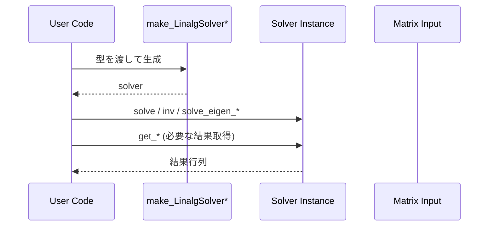

# 04. 線形代数ソルバ（solve/inv/cholesky/qr/eig）

この章は `sample/left_divide.cpp` / `inverse.cpp` / `cholesky.cpp` / `qr.cpp` / `eigen_values_vectors_*.cpp` の使い方をまとめたものです。

## 4.1 連立一次方程式（左除算）

```cpp
auto solver = make_LinalgSolver<decltype(A), decltype(C)>();
LinalgSolver_Type<decltype(A), decltype(C)> solver_t = solver;
auto result = solver_t.solve(A, C);
```

NumPy 対応: `np.linalg.solve(A, C)`

---

## 4.2 逆行列

```cpp
auto solver = make_LinalgSolverInv<decltype(A)>();
LinalgSolverInv_Type<decltype(A)> solver_t = solver;
auto result = solver_t.inv(A);
```

NumPy 対応: `np.linalg.inv(A)`

---

## 4.3 コレスキー分解

```cpp
auto solver = make_LinalgSolverCholesky<decltype(A)>();
LinalgSolverCholesky_Type<decltype(A)> solver_t = solver;
auto SA = solver_t.solve(A);
```

`sample/cholesky.cpp` では、さらに `ATranspose_mul_B(SA, SA)` で再構成を確認しています。

---

## 4.4 QR 分解

```cpp
auto solver = make_LinalgSolverQR<decltype(A)>();
LinalgSolverQR_Type<decltype(A)> solver_t = solver;

solver_t.solve(A);
auto Q = solver_t.get_Q();
auto R = solver_t.get_R();

auto R_1_A = solver_t.backward_substitution(A);
```

NumPy 対応:

- `solver_t.solve(A)` + `get_Q()/get_R()` ↔ `Q, R = np.linalg.qr(A)`

---

## 4.5 固有値・固有ベクトル（実数）

```cpp
auto solver_r = make_LinalgSolverEigReal<decltype(A_r)>();
LinalgSolverEigReal_Type<decltype(A_r)> solver_r_t = solver_r;

solver_r_t.solve_eigen_values(A_r);
auto eigen_values_r = solver_r_t.get_eigen_values();

solver_r_t.solve_eigen_vectors(A_r);
auto eigen_vectors_r = solver_r_t.get_eigen_vectors();
```

NumPy 対応: `np.linalg.eig(A_r)`

---

## 4.6 固有値・固有ベクトル（複素）

```cpp
auto solver_c = make_LinalgSolverEig<decltype(A_c)>();
LinalgSolverEig_Type<decltype(A_c)> solver_c_t = solver_c;
```

`sample/eigen_values_vectors_complex.cpp` では、複素型結果（実部・虚部）を表示し、`A*V - V*D` で検証しています。

---

## 4.7 ソルバ系サンプルの読み方



