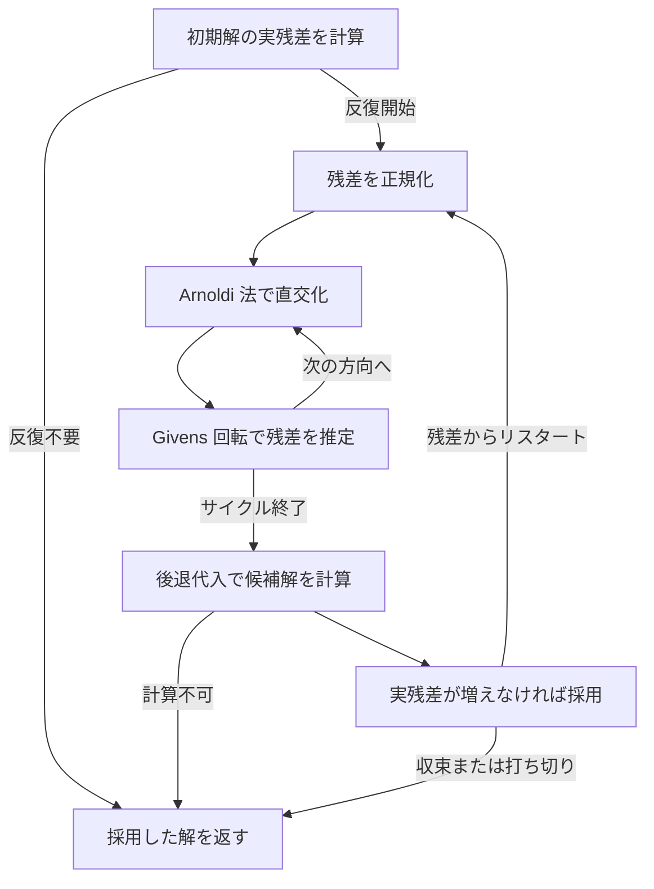

# GMRES 法で連立一次方程式を解く

GMRES 法（一般化最小残差法）は、正方行列 $A$ と右辺 $b$ に対して $Ax=b$ の近似解を求めます。近似解 $x$ を元の式に代入したときのずれ $r=b-Ax$ を**残差**と呼びます。GMRES は解を修正できる方向を 1 本ずつ増やし、その範囲で残差の長さが最小になる修正を選びます。$A$ が非対称でもこの手順を使えます。

## 2 行 2 列の例

```math
A=\begin{pmatrix}2&1\\0&1\end{pmatrix},\qquad
b=\begin{pmatrix}0\\1\end{pmatrix},\qquad x_0=\begin{pmatrix}0\\0\end{pmatrix}.
```

最初の残差は $r_0=b$ です。最初の 1 ステップで選べる修正はこの方向だけなので、候補は $x=t r_0$ です。残差の長さの二乗は次のようになります。

```math
\lVert b-A(t r_0)\rVert_2^2=t^2+(1-t)^2.
```

これは $t=1/2$ で最小になり、残差の長さは $1$ から $1/\sqrt{2}$ に減ります。2 ステップ目には $A r_0=(1,1)^{\mathsf T}$ の方向も使えます。$r_0$ と $Ar_0$ の組み合わせで平面全体を探索できるため、厳密な算術では $x=(-1/2,1)^{\mathsf T}$ が得られ、残差は $0$ になります。

```cpp
using namespace PythonNumpy;
auto A = make_DenseMatrix<2, 2>(2.0, 1.0, 0.0, 1.0);
auto b = make_DenseMatrix<2, 1>(0.0, 1.0);
auto solver = make_LinalgSolver<decltype(A), decltype(b)>();
solver.set_decay_rate(1.0e-12);
auto x = solver.solve(A, b);
```

この例では `solver.rho[0]` が返された解の残差ノルム、`solver.rep_num[0]` が実行した Arnoldi ステップ数です。行列を右辺とする例は [left_divide.cpp](../../sample/left_divide.cpp) にあります。

## 探索方向の作り方と解の更新

例で使った $r_0,Ar_0$ を一般化すると、サイクル開始時の残差 $r$ から $j$ ステップで探索できる方向は次の部分空間になります。これをクリロフ部分空間と呼びます。

```math
\mathcal K_j(A,r)=\operatorname{span}\{r,Ar,\ldots,A^{j-1}r\}.
```



1. **残差から探索を始める。** サイクル開始時の解を $x_s$ とし、$r=b-Ax_s$、$\beta=\lVert r\rVert_2$ とします。残差が許容値を超えていれば、$q_1=r/\beta$ を最初の基底ベクトルにします。
2. **探索方向を増やす（Arnoldi 法）。** $w=Aq_j$ を計算し、既に求めた $q_1,\ldots,q_j$ の成分を順番に差し引きます。これが修正 Gram–Schmidt 法です。各成分の係数を $h_{ij}$ に記録し、最後に残った長さを $h_{j+1,j}$ とします。十分な長さがあれば正規化して次の基底を得ます。実装は複素数にも対応し、射影係数を $q_i^{\ast}w/(q_i^{\ast}q_i)$ で計算します。ここで $q_i^{\ast}$ は共役転置です。直交化を 2 回に設定した場合は各回の係数を加算します。
3. **小さな最小二乗問題を解く。** $j$ 本の基底を並べた行列を $Q_j$、係数を並べた $(j+1)\times j$ 行列を $\bar H_j$、最初の単位ベクトルを $e_1$ とします。修正を $Q_j y$ と書けば、残差を最小にする問題は次の形になります。

   ```math
   \min_y \lVert b-A(x_s+Q_jy)\rVert_2
   \quad\Longleftrightarrow\quad
   \min_y \lVert \beta e_1-\bar H_j y\rVert_2.
   ```

   実装は列を追加するたびに隣り合う 2 行を回転し、$\bar H_j$ の対角の直下をゼロにします（Givens 回転）。同じ回転を $\beta e_1$ に適用すると、末尾の成分の大きさから残差を推定できます。サイクルの最後に上三角になった部分を後退代入して $y$ を求めます。

4. **元の方程式で候補を確かめる。** $x_{\mathrm{cand}}=x_s+Q_jy$ に対して $\lVert b-Ax_{\mathrm{cand}}\rVert_2$ を再計算します。サイクル開始時より残差が増えなければ候補を採用します。未収束で次のサイクルに進める場合は、採用済みの解の残差から基底を作り直します。これがリスタートです。

## 停止条件と設定

収束を決めるのは採用済みの解の**実残差**です。初期解が次の条件を満たせば反復回数は $0$ です。式の $a$ と $s$ は、それぞれ絶対許容誤差と相対許容誤差です。

```math
\lVert b-Ax\rVert_2 \le a+s\lVert b\rVert_2.
```

| 設定 | `Base::Matrix::GmresSolver<T, N, K>` の既定 | `make_LinalgSolver` の GMRES 経路 |
| --- | --- | --- |
| 1 サイクルの探索次元 | `krylov_dimension = K`。テンプレート引数 `K` の既定は `N` | 正方系の次元 `N` |
| サイクル数、直交化回数 | `cycles = 1`、`orthogonalization_passes = 1` | 1 サイクル、直交化 1 回 |
| 絶対／相対許容誤差 | `absolute_tolerance = 0`、`relative_tolerance = 1e-12` | 絶対は `0`、相対は `set_decay_rate` で設定（既定 `0`） |
| 後退代入の分母の下限 | `division_min = 1e-10` | `set_division_min` で設定（既定 `1e-23`） |

`GmresSolver` が実行する Arnoldi ステップ数の上限は、実際に使う探索次元とサイクル数の積です。直交化後の長さが直交化前の長さの $8\times10^{-12}$ 倍以下になると、新しい方向の生成を打ち切り、その時点の候補で実残差を調べます。

- **収束** — 実残差が条件を満たすと `is_converged()` が真になります。
- **ブレークダウン** — 新しい方向を生成できず実残差が許容値を超えた場合、または後退代入の対角が下限を下回った場合は `has_breakdown()` が真になります。
- **反復上限** — どちらのフラグも偽のままサイクルを使い切ることがあります。返り値は最後に採用した近似解です。`get_residual_norm()` と `get_iterations()` で最終残差と実際の反復回数を確認できます。

### 実数の密な正方行列で速度と精度を切り替える

2 次元以上の全サイズの密な実正方行列では、`gmres_k` とそれを使う左除算・逆行列の計算方法を [base_matrix_gmres.hpp](../../base_matrix/base_matrix_gmres.hpp) の定数で選べます。

```cpp
constexpr bool BASE_MATRIX_INVERSE_KEEP_PRECISION = false;
```

既定の `false` は、通常の大きさの入力では平方和から逆平方根を一度求め、次の基底の正規化にも使います。直交化前のノルム計算を省くため、ほぼ従属な探索方向でも反復を続けることがあり、解や反復回数が変わる場合があります。`true` はスケーリング付きノルムと直交化前後の相対判定を使います。どちらも候補解の実残差を計算し、残差が増えた候補を棄却します。

## 同じ反復を使う処理

| 入力・呼び出し | GMRES に渡す問題 |
| --- | --- |
| 密・疎の正方行列の左除算 `solve(A, B)` | 右辺の各列 $b_j$ について $Ax_j=b_j$ を解く。繰り返しの呼び出しでは前回の解を初期値に使う。対角行列型の $A$ は対角成分による直接の除算を使う。 |
| 密・疎の正方行列の逆行列 `inv(A)` | 正則な $A$ に対し、単位行列の各列 $e_j$ を右辺にして $Ax_j=e_j$ を解く。$x_j$ を並べたものが逆行列の近似になる。[inverse.cpp](../../sample/inverse.cpp) |
| 縦長の実行列の最小二乗 `make_LinalgLstsqSolver` | 正規方程式 $A^{\mathsf T}A x=A^{\mathsf T}b$ を解く。返す残差ノルムは元の入力から再計算した $\lVert A^{\mathsf T}(b-Ax)\rVert_2$。 |
| 固有ベクトルの計算 `solve_eigen_vectors` | 一般の実行列では、固有値の推定値を少しずらして作った連立方程式を解き、その解を正規化して次の候補にする。[固有ベクトルの計算](./05_eigenvectors.md) |
| 基底方向のスケールを調整する `GmresSolver::solve_preconditioned` | 右対角前処理を使い、基底を作る積を $AD^{-1}q_j$、元の座標での修正量を $D^{-1}Q_j y$ とする。収束は元の $Ax=b$ の残差で判定する。 |

反復本体は [base_matrix_gmres.hpp](../../base_matrix/base_matrix_gmres.hpp)、列ごとの処理と正規方程式は [base_matrix_inverse.hpp](../../base_matrix/base_matrix_inverse.hpp)、公開 API と既定値は [python_numpy_linalg_solver.hpp](../../python_numpy/python_numpy_linalg_solver.hpp) で確認できます。

[ドキュメント目次に戻る](../README.md)
