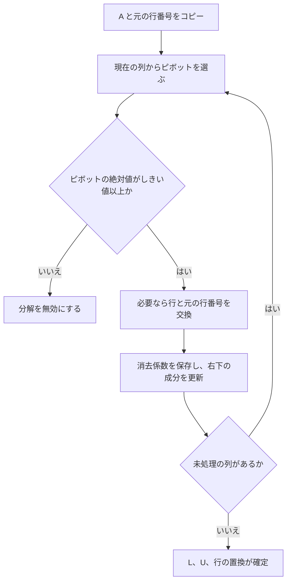

# LU 分解（部分ピボット選択）

LU 分解は、正方行列 $A$ の行を並べ替え、下三角行列 $L$ と上三角行列 $U$ の積に分ける方法です。この実装の置換行列を $P$ とすると、次の関係が成り立ちます。$L$ の対角成分はすべて $1$ です。

```math
PA=LU, \qquad A=P^{\mathsf T}LU.
```

たとえば $Ax=b$ を解くとき、分解を一度済ませれば、右辺を変えるたびに $Ly=Pb$ と $Ux=y$ を順に解くだけで済みます。

## 1 列ずつ消去する

作業行列 $W$ を $A$ のコピーで初期化します。列番号を $k=0,\ldots,n-1$ とすると、各列で次の操作を行います。

1. **ピボットを選ぶ。** 第 $k$ 列のうち、第 $k$ 行から下で絶対値が最大の要素を探し、その行を $p$ とします。これから割り算に使う値がピボットです。
2. **行を入れ替える。** ピボットの絶対値がしきい値を下回れば分解は失敗です。受け入れられたら、第 $k$ 行と第 $p$ 行の全体を交換し、元の行番号も同じように交換します。すでに求めた $L$ の成分も行とともに移動します。
3. **対角より下を消去する。** 各行 $i>k$ について、第 $k$ 行の何倍を引けばよいかを表す係数 $\ell_{ik}$ を求めます。右下の部分行列を更新し、消去した位置 $W_{ik}$ にこの係数を保存します。

```math
\ell_{ik}=\frac{W_{ik}}{W_{kk}}, \qquad
W_{ij}\leftarrow W_{ij}-\ell_{ik}W_{kj} \quad (i>k,\ j>k).
```

全列を処理すると、$W$ の対角から上に $U$、対角より下に $L$ の消去係数が残ります。実装はこの 1 枚の行列と元の行番号を保持し、取得時に $L$、$U$、$P$ を組み立てます。



## 行交換が起きる例

次の $A$ では第 1 列の $2$ をピボットに選ぶため、2 行を入れ替えます。並べ替えた後の第 2 行から第 1 行の $1/2$ 倍を引くと、右下の値は $3-(1/2)\cdot 4=1$ になります。

```math
A=\begin{bmatrix}1&3\\2&4\end{bmatrix},\quad
P=\begin{bmatrix}0&1\\1&0\end{bmatrix},\quad
L=\begin{bmatrix}1&0\\1/2&1\end{bmatrix},\quad
U=\begin{bmatrix}2&4\\0&1\end{bmatrix}.
```

行交換が $s$ 回なら $\det(A)=(-1)^s\prod_i U_{ii}$ です。この例では行交換が 1 回なので、行列式は $-2$ です。

```cpp
using namespace PythonNumpy;
auto A = make_DenseMatrix<2, 2>(1.0, 3.0, 2.0, 4.0);
auto lu = make_LinalgSolverLU<decltype(A)>();
lu.solve(A);
if (lu.is_valid()) {
  auto PA = lu.get_P() * A;
  auto LU = (lu.get_L() * lu.get_U()).create_dense();
  auto det = lu.get_det();
}
```

## 入力の種類としきい値

公開 API は実数型（`float` または `double`）の正方行列を受け取ります。`get_L()` と `get_U()` は三角部分を保持する疎行列、`get_P()` は密行列を返します。`get_pivot_indices()` の第 $i$ 要素は、並べ替え後の第 $i$ 行が入力のどの行だったかを示します。

| 入力 | `solve(A)` の処理 |
|---|---|
| 密行列 | 部分ピボット選択付きの消去を行う。`set_division_min()` で分解前にしきい値を指定できる。 |
| 疎行列 | 入力を密行列に展開し、密行列と同じ消去を行う。 |
| 対角行列 | $P=L=I$、$U=A$ として対角成分だけを検査する。専用の分解器を作り直すため、この経路は既定のしきい値を使う。 |

既定の `division_min` は $10^{-10}$ です。ピボットの絶対値がしきい値を**下回る**と `is_singular()` が真、`is_valid()` が偽となり、`get_det()` は $0$ を返します。この判定は絶対値に基づくため、数学的に正則な行列でも全体のスケールによって結果が変わります。

## 分解した因子を使って右辺を解く

`Base::Matrix::LUDecomposition` では、`solve(A)` 後に `solve_rhs(b)` を呼び出せます。まず $Ly=Pb$ を上の行から前進代入で、次に $Ux=y$ を下の行から後退代入で解きます。分解済みの行列に対しては、右辺ごとにこの 2 回の代入だけを繰り返します。無効な分解で `solve_rhs(b)` を呼ぶとゼロベクトルが返るため、分解の成否は `is_valid()` で確認します。

同じクラスの `solve_scaled(A)` では、元の各行の最大絶対値を使ってピボット候補を比較します。選んだピボットを受け入れる判定には引き続き `division_min` を使います。`refine(A, b, x, corrections)` では、残差 $r=b-Ax$ に対して同じ因子で $A\Delta x=r$ を解き、指定回数だけ $x\leftarrow x+\Delta x$ と補正します。

実装と照合するには、[公開 API](../../python_numpy/python_numpy_linalg_lu.hpp)、[分解・代入の実装](../../base_matrix/base_matrix_lu_decomposition.hpp)、[行の置換と行列式を確認するテスト](../../test_vs/check_python_numpy.hpp) を参照してください。

[ドキュメント目次へ](../README.md)
