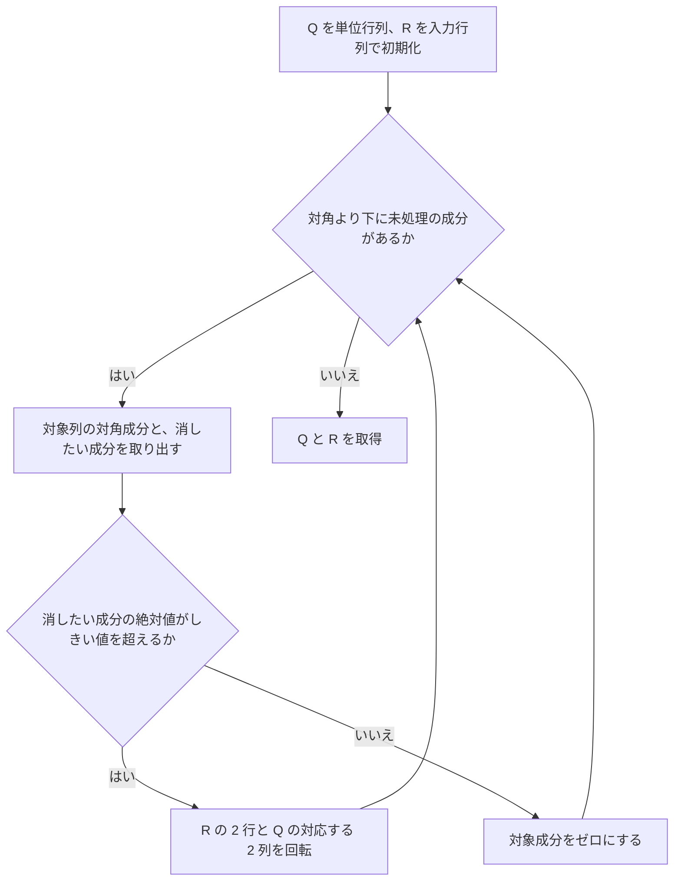

# QR 分解（Givens 回転と Householder 反射）

QR 分解は、実数行列 $A$ を、互いに直交する単位ベクトルを列に持つ行列 $Q$ と、対角より下がゼロの行列 $R$ に分けます。公開 API で密行列・疎行列を分解するときは、Givens 回転で下三角部分の成分を 1 個ずつゼロにします。

```math
A=QR,\qquad Q^{\mathsf T}Q=I_m.
```

入力が $m$ 行 $n$ 列（$m\ge n>0$）なら、返される $Q$ は $m$ 行 $m$ 列、$R$ は $m$ 行 $n$ 列です。縦長の行列では $R$ の上側 $n$ 行が上三角行列、下側 $m-n$ 行がゼロになります。

## 2 行を回転させる

初期値を $Q=I_m$、$R=A$ とします。列 $j$ の対角成分を $f=R_{jj}$、消したい成分を $g=R_{ij}$（$i>j$）とします。第 $j$ 行と第 $i$ 行の組に次の回転をかけると、第 2 成分がゼロになります。

```math
G=\begin{bmatrix}c&-s\\s&c\end{bmatrix},\qquad
c^2+s^2=1,\qquad
G\begin{bmatrix}f\\g\end{bmatrix}
=\begin{bmatrix}cf-sg\\0\end{bmatrix}.
```

実装は $f,g$ のうち絶対値が大きい方で小さい方を割り、その比から $c,s$ を計算します。こうすると、元の成分を直接二乗せずに回転を求められます。選んだ 2 行に作用する回転を $G_{ji}$ と書くと、更新は次のとおりです。

```math
R\leftarrow G_{ji}R,\qquad Q\leftarrow QG_{ji}^{\mathsf T}.
```

$G_{ji}^{\mathsf T}G_{ji}=I_m$ なので、両方を更新しても積 $QR$ は保たれます。左端の列から順に、各列では対角のすぐ下から下端までを処理します。`division_min` は既定で $10^{-10}$ です。消したい成分の絶対値がこの値以下なら、回転を省いてその成分をゼロにするため、元の $A$ の再構成にはその近似も影響します。



## 1 回の回転で分解できる例

第 1 列が $(4,3)^{\mathsf T}$ の場合、実装の符号規約では $c=4/5,\ s=-3/5$ です。回転後の第 1 列は $(5,0)^{\mathsf T}$ になります。第 2 列にも同じ回転を適用すると、次の分解が得られます。

```math
\underbrace{\begin{bmatrix}4&0\\3&5\end{bmatrix}}_{A} =
\underbrace{\begin{bmatrix}4/5&-3/5\\3/5&4/5\end{bmatrix}}_{Q}
\underbrace{\begin{bmatrix}5&3\\0&4\end{bmatrix}}_{R}.
```

```cpp
using namespace PythonNumpy;
auto A = make_DenseMatrix<2, 2>(4.0, 0.0, 3.0, 5.0);
auto qr = make_LinalgSolverQR<decltype(A)>();
qr.solve(A);
auto Q = qr.get_Q();
auto R = qr.get_R();
auto reconstructed = Q * R;
```

$Q$ のある列と $R$ の対応する行の符号を同時に反転しても、$QR$ は同じです。他の実装と比べるときは、$QR$ が $A$ に、$Q^{\mathsf T}Q$ が単位行列にどれだけ近いかを確認できます。両言語で再構成を試す例は [C++ のサンプル](../../sample/qr.cpp) と [NumPy のサンプル](../../sample/qr.py) にあります。

## 公開 API で入力型が変わるとき

| 入力 | `make_LinalgSolverQR` が選ぶ計算 | 返される因子 |
|---|---|---|
| 密行列 | 入力を作業行列 $R$ にコピーして Givens 回転を適用する。 | 密な $Q$、上三角部分を格納した疎行列 $R$ |
| 疎行列 | ゼロで初期化した密な $R$ に格納されている成分を転記し、同じ回転を適用する。消去の途中で新たに生じる非ゼロ成分も保持できる。 | 密な $Q$、上三角部分を格納した疎行列 $R$ |
| 対角行列 | 入力がすでに上三角なので $Q=I$、$R=A$ とする。 | どちらも対角行列 |

サンプル末尾の `qr.backward_substitution(A)` は、得られた正方の $R$ について $RX=A$ を後退代入で解く例です。`qr.solve(A)` は因子 $Q,R$ を作る処理です。

## base_matrix で選べる他の計算方法

**上 Hessenberg 行列の Givens 回転。** 上 Hessenberg 行列では、対角の 1 本下までしか非ゼロ成分が現れません。`Base::Matrix::QRDecomposition::solve_hessenberg(A)` は、入力がこの形であることを前提に、各列で対角直下の成分だけを処理します。一般の `solve(A)` と同じ形式の $Q,R$ を返せます。いずれの方法でも、分解後の $R$ の対角成分に絶対値が `division_min` 以下のものがあると、このクラスの `get_rank_deficient()` が真になります。

**Householder 反射。** `Base::Matrix::QRDecompositionHouseholder` は、列 $j$ の対角から下の部分をベクトル $x$ とみなし、1 回の反射でその先頭以外をまとめてゼロにします。反射を表すベクトルを $v$、係数を $\tau$ とすると、残りの各列の該当部分 $z$ は次の式で更新できます。

```math
H=I-\tau vv^{\mathsf T},\qquad Hz=z-\tau v(v^{\mathsf T}z).
```

列のノルムは最大絶対値でスケーリングしてから計算します。その最大絶対値が `division_min` 以下の列では反射を省き、`get_rank_deficient()` が真になります。分解時には作業行列の上側に $R$、対角より下に $v$ の末尾を保存し、$\tau$ を別に保持します。`get_Q()` は必要になった時点で反射を逆順に単位行列へ適用して $Q$ を作ります。`apply_Q_transpose(b)` は反射を分解時と同じ順に $b$ へ適用するため、密な $Q$ を作らずに $Q^{\mathsf T}b$ を計算できます。

[公開 API](../../python_numpy/python_numpy_linalg_qr.hpp) · [Givens 回転・Householder 反射の実装](../../base_matrix/base_matrix_qr_decomposition.hpp) · [ドキュメント目次へ](../README.md)
