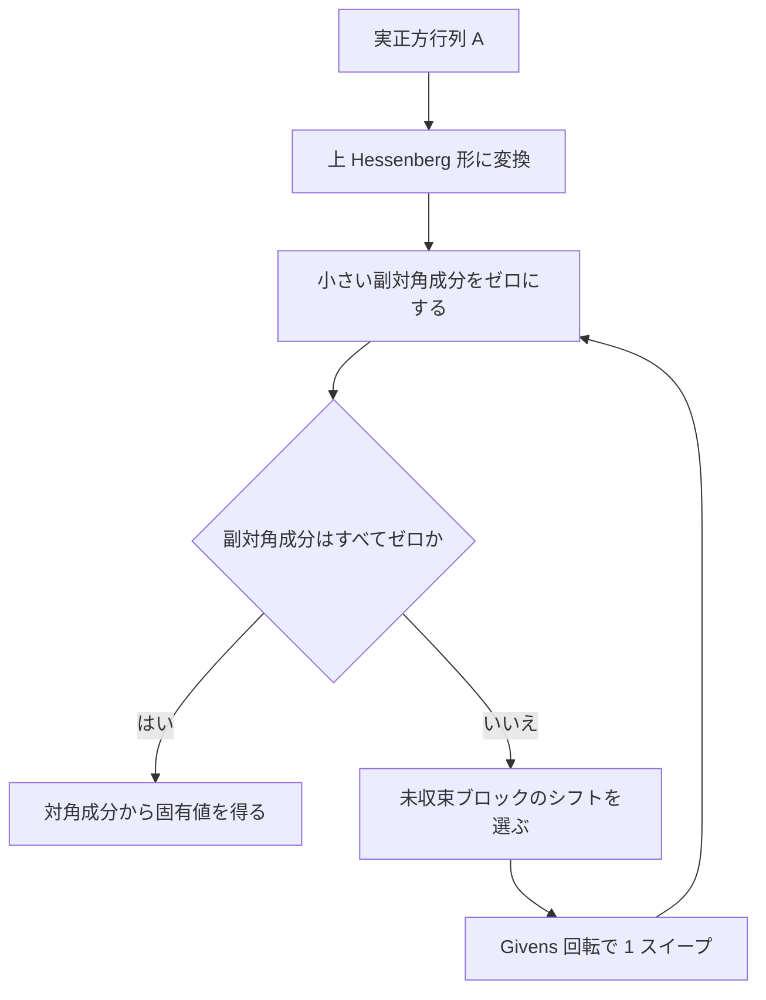

# 固有値の計算

行列 $A$ を掛けると自分自身の定数倍になるベクトル $v\ne 0$ を、固有ベクトルと呼びます。$Av=\lambda v$ を満たす倍率 $\lambda$ が固有値です。このライブラリでは、有限の実数（`float` または `double`）を要素とする正方行列を入力し、行列の型と選んだソルバに応じて次の方法で固有値を求めます。

| 入力と入口 | 固有値の求め方 |
| --- | --- |
| 密行列型の `make_LinalgSolverEigReal` / `make_LinalgSolverEig` | Hessenberg 形に変換し、シフト付き QR 法で対角成分に固有値を集める |
| 疎行列型の同じファクトリ | 密行列に展開して同じ計算を行う |
| 対角行列型の同じファクトリ | 対角成分を元の順に取り出す |
| 実対称行列に `Base::Matrix::EigenSolverSymmetric` を直接使う場合 | 巡回 Jacobi 法で対角化する |

`EigReal` は実数の固有値を、`Eig` は複素共役の対を含む固有値を扱います。どちらの `get_eigen_values()` も、得た順に並べた列ベクトルを返します。

## 一般の実行列をシフト付き QR 法で解く

相似変換 $H=Q^{\ast} A Q$ は固有値を保ちます。ここで $Q$ はユニタリ行列で、$Q^{\ast}$ は共役転置（実数では転置）です。この性質を使い、固有値を読み取りやすい上三角行列へ少しずつ変形します。



### 1. 上 Hessenberg 形にする

Householder 反射を左右から掛け、対角の一つ下（副対角）より下をゼロにします。この形なら次の QR 反復では、隣り合う行と列を順に回転させるだけで形を保てます。

### 2. 最下部の未収束ブロックでシフトを選ぶ

末尾の $2\times2$ ブロックの上の行を $(a,b)$、下の行を $(c,d)$ とすると、その固有値の候補は次式です。実装はブロックをスケーリングして計算し、通常は $d$ に近い候補をシフト $\mu$ に使います。

```math
\mu_{\pm}=\frac{a+d}{2}\ \pm\ \sqrt{\left(\frac{a-d}{2}\right)^2+bc}
```

### 3. シフト付き QR を 1 スイープ進める

数式では、対象ブロック $H_k$ から $\mu I$ を引いて QR 分解し、積の順を入れ替えて $\mu I$ を戻します。結果は相似変換なので、固有値が保たれます。

```math
H_k-\mu I=QR,\qquad H_{k+1}=RQ+\mu I=Q^{\ast}H_kQ
```

実装は $Q,R$ を陽に作らず、Givens 回転を左右から掛けます。回転で一時的に副対角の下に現れる成分を次の回転で消し、ブロックの末尾まで進みます。停滞を避けるため、実行したスイープの 8 回目ごとに、末尾の行の対角成分とその左隣を使ってシフトを $h_{m,m}+\lvert h_{m,m-1}\rvert$ とします。

### 4. 副対角成分を切り離す

次式を満たす $h_{i,i-1}$ をゼロにすると、そこで上下の対角ブロックを独立に扱えます。この処理をデフレーションと呼びます。

```math
\lvert h_{i,i-1}\rvert \le \tau_{\mathrm{abs}}+\tau_{\mathrm{rel}}s_i,\qquad
s_i=\lvert h_{i-1,i-1}\rvert+\lvert h_{i,i}\rvert
```

隣り合う対角成分が両方ゼロのときは、$s_i$ に入力の最大絶対成分 $\max_{p,q}\lvert a_{p,q}\rvert$ を使います。既定値は $\tau_{\mathrm{abs}}=0$、$\tau_{\mathrm{rel}}=10^{-6}$ です。すべての副対角成分を切り離せたとき、対角成分が収束した固有値です。

### 実数ソルバと複素数ソルバを選ぶ例

次の行列は平面上でベクトルを 90 度回転させます。固有方程式が $\lambda^2+1=0$ なので、固有値は $+i$ と $-i$ です。

```math
A=\begin{pmatrix}0&-1\\1&0\end{pmatrix}
```

実数ソルバは、孤立した $2\times2$ ブロックで平方根の中身が負になると `complex_pair` を記録します。このとき保持している対角成分は途中の推定値です。より大きい未収束ブロックで同じことが起きた場合は、候補の実部を通常のシフトに使い、反復を続けます。この例のように複素固有値があり得る場合は、最初から `make_LinalgSolverEig` を使うと、実数行列をそのまま渡して両方の固有値を得られます。

```cpp
using namespace PythonNumpy;
auto A = make_DenseMatrix<2, 2>(0.0, -1.0, 1.0, 0.0);
auto solver = make_LinalgSolverEig<decltype(A)>();
solver.solve_eigen_values(A);
auto values = solver.get_eigen_values();  // 各行に 1 個の複素固有値
```

`solve_eigen_values(A)` は $n$ 次行列に対して既定で最大 $10n$ スイープ分を計算します。`continue_solving_eigen_values()` は保存済みの Hessenberg 行列からもう一度その回数分だけ進めます。収束状態をプログラムで調べる場合、下位の `Base::Matrix::EigenSolverReal` / `EigenSolverComplex` には `eigen_values_converged()`、`get_status()`、実際に行った累積スイープ数を返す `get_sweep_count()` があります。

## 実対称行列を巡回 Jacobi 法で解く

呼び出し側で $A=A^{\mathsf T}$ が分かっているときは、`Base::Matrix::EigenSolverSymmetric<T, N, ComputeVectors>` を選べます。上三角だけを作業領域に読み込むため、対称性は呼び出し側で保証します。

1. すべての添字対 $p<q$ を順に訪れます。$|a_{pq}|$ が許容誤差を超えるとき、その成分をゼロにする平面回転 $J$ を選んで $A\leftarrow J^{\mathsf T}AJ$ と更新します。
2. 一巡を 1 スイープとし、既定で 10 スイープ実行します。すべての非対角成分が入力全体を基準とする $\tau_{\mathrm{abs}}+\tau_{\mathrm{rel}}\max_{i,j}\lvert a_{ij}\rvert$ 以下なら収束です。許容誤差の既定値は一般ソルバと同じです。
3. `get_eigen_values()` で対角の推定値を得ます。`eigen_values_converged()` で判定し、必要なら `continue_solving_eigen_values()` で現在の状態から続けられます。`ComputeVectors=false` なら回転を蓄積する固有ベクトル用の領域を省けます。

## 関連資料

- [対応する固有ベクトルの計算と検算](05_eigenvectors.md)
- [Base の固有値ソルバ](../../base_matrix/base_matrix_eigen_solver.hpp)・[PythonNumpy の型別処理](../../python_numpy/python_numpy_linalg_eig.hpp)
- [実固有値のサンプル](../../sample/eigen_values_vectors_real.cpp)・[複素固有値のサンプル](../../sample/eigen_values_vectors_complex.cpp)
- [ドキュメント目次に戻る](../README.md)
