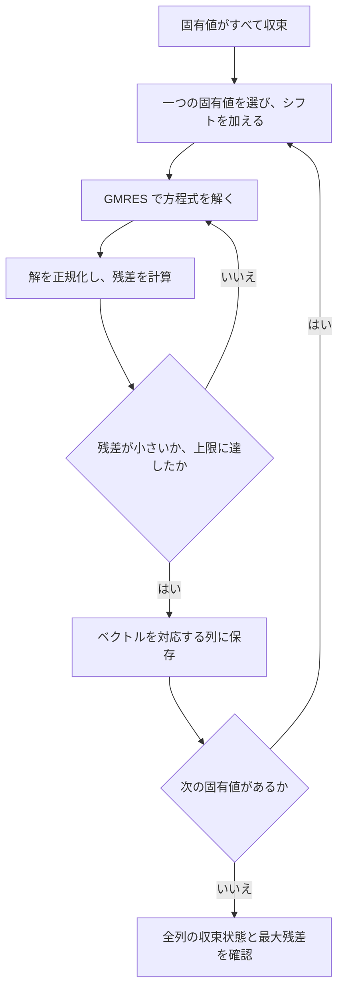

# 固有ベクトルの計算

固有値 $\lambda_j$ に対する右固有ベクトル $v_j$ は、$Av_j=\lambda_jv_j$ を満たすゼロでないベクトルです。`get_eigen_vectors()` が返す行列 $V$ の **第 $j$ 列**が、`get_eigen_values()` の第 $j$ 成分に対応します。列を並べたまま次式で検算できます。

```math
V=\begin{pmatrix}v_1&\cdots&v_n\end{pmatrix},\qquad
D=\operatorname{diag}(\lambda_1,\ldots,\lambda_n),\qquad
AV=VD
```

## 一般の実行列にはシフト付き逆反復を使う

密行列型では、まず `solve_eigen_values(A)` を呼びます。次に**同じソルバに同じ行列**を渡して `solve_eigen_vectors(A)` を呼びます。すべての固有値が収束していれば、逆反復で各列を個別に求めます。固有値が反復上限までに収束しなかったときは、`continue_solving_eigen_values()` で固有値の計算を続けられます。疎行列型でも、入力を密行列に展開して同じ手順をたどります。[固有値の計算](04_eigenvalues.md)



### 1. 固有値を少しずらす

正確な固有値で $A-\lambda_j I$ を作ると、$v_j$ がゼロに写り、行列が特異になります。そこで入力の最大絶対成分 $s=\max_{i,k}\lvert a_{ik}\rvert$（ゼロ行列では $s=1$）に合わせて、小さな実数 $\delta$ を加えます。

```math
\delta=\max\bigl(\lvert\text{small\_value}\rvert\,s,\ \text{division\_min}\bigr),
\qquad B_j=A-(\lambda_j+\delta)I
```

`small_value` の既定値は $3\times10^{-4}$、`division_min` は $10^{-20}$ です。`make_LinalgSolverEig` では $\lambda_j$、$B_j$、計算するベクトルが複素数になります。

### 2. 方程式を解き、長さを 1 に戻す

初回の開始ベクトル $v^{(0)}$ は全成分を 1 とし、対象の列に対応する成分だけ 2 にして正規化します。各反復では次の連立方程式を初期解ゼロの GMRES で近似的に解き、その解を正規化します。[GMRES 法](01_gmres.md)

```math
B_j w^{(k+1)}=v^{(k)},\qquad
v^{(k+1)}=\frac{w^{(k+1)}}{\lVert w^{(k+1)}\rVert_2}
```

$Au=\lambda u$ を満たす方向 $u$ では、$B_j u=(\lambda-\lambda_j-\delta)u$ です。方程式を解く操作は、この方向の成分を $1/(\lambda-\lambda_j-\delta)$ 倍します。シフトに最も近い固有値の成分が相対的に大きくなるので、開始ベクトルにその成分が含まれていれば、正規化を繰り返すとその方向が強調されます。

### 3. 元の固有方程式で収束を判定する

各列の更新後、シフトを加える前の固有値 $\lambda_j$ で次の残差を求めます。$\rho_j$ は、求めたベクトルが元の式をどれだけ満たすかを、行列の大きさに合わせて測った値です。

```math
\rho_j=\frac{\lVert Av_j-\lambda_j v_j\rVert_2}{s}
```

- **外側の逆反復**は各列につき既定で最大 30 回です。$\rho_j\leq 4\times10^{-6}$ が既定の収束基準です。`solve_eigen_vectors(A)` を再度呼ぶと、前回保存した各列を開始方向に使います。
- **内側の GMRES** は既定で Krylov 次元が行列サイズと等しく、1 サイクル、直交化 1 回、相対許容誤差 $10^{-3}$ です。内側の方程式が解けたかどうかと、元の固有方程式が要求精度を満たしたかどうかは、それぞれの残差で判定します。
- **下位ソルバの診断**では、`eigen_vectors_converged()` が全列の収束、`get_eigenvector_residual()` が $\max_j\rho_j$ を返します。正規化前のノルムが `division_min` 以下なら `zero_vector`、非ゼロの候補を得ても内側の GMRES が未収束のまま破綻した場合は `inner_failure` を記録します。

### 複素固有ベクトルを検算する例

次の回転行列で $\lambda=i$ なら、$v=(1,-i)^{\mathsf T}/\sqrt{2}$ が一つの解です。$Av=(i,1)^{\mathsf T}/\sqrt{2}=iv$ と確かめられます。実数では符号を反転したベクトルも解で、複素数では絶対値 1 の複素数を掛けても正規化された解です。NumPy の出力と比較するときも、列の順序とこの自由度を考慮し、元の式に代入した残差を調べます。

```cpp
using namespace PythonNumpy;
auto A = make_DenseMatrix<2, 2>(0.0, -1.0, 1.0, 0.0);
auto solver = make_LinalgSolverEig<decltype(A)>();
solver.solve_eigen_values(A);
solver.solve_eigen_vectors(A);
auto V = solver.get_eigen_vectors();
auto residual = solver.check_validity(A);  // A * V - V * D の各成分
```

## 対角行列と実対称行列

**対角行列型**では、各標準基底 $e_j$ がすでに $Ae_j=a_{jj}e_j$ を満たします。PythonNumpy の対角行列用ソルバは固有ベクトルとして単位行列を返します。

**実対称行列用の Jacobi 法**では、各回転 $J$ と同時に $V$ を更新します。`Base::Matrix::EigenSolverSymmetric<T, N, true>` は $V_0=I$ とし、対角化の過程で次の二つを計算します。

```math
A_{k+1}=J_k^{\mathsf T}A_kJ_k,\qquad V_{k+1}=V_kJ_k
```

$A_k=V_k^{\mathsf T}AV_k$ が対角行列に近づくと、$V_k$ の各列が直交する固有ベクトルに近づきます。このソルバでは `solve_eigen_values(A)` の段階で列も更新され、`get_eigen_vectors()` で取り出せます。一般行列用の逆反復には列同士を直交化する処理がないため、重複した固有値に対して各列の残差が小さくても、それらが独立な基底を成す保証はありません。

## 関連資料

- [Base の固有ベクトル計算](../../base_matrix/base_matrix_eigen_solver.hpp)・[PythonNumpy の型別処理](../../python_numpy/python_numpy_linalg_eig.hpp)
- [実数のサンプル](../../sample/eigen_values_vectors_real.cpp)・[複素数のサンプル](../../sample/eigen_values_vectors_complex.cpp)
- [ドキュメント目次に戻る](../README.md)
