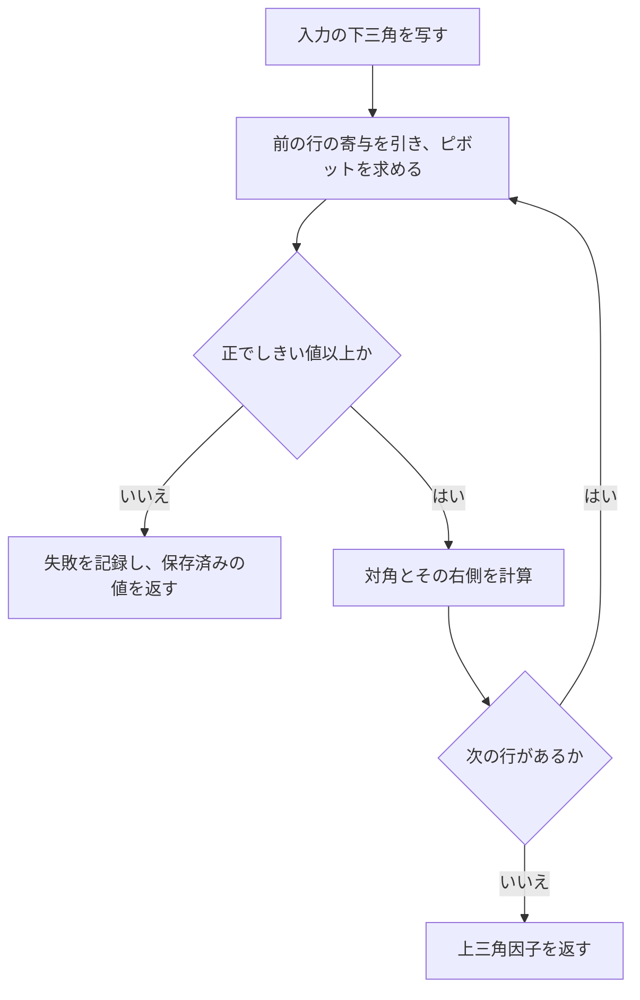

# コレスキー分解

コレスキー分解は、実対称正定値行列 $A$ を、対角成分が正の上三角行列 $U$ を使って次の形に分けます。正定値とは、どのゼロでないベクトル $x$ についても $x^{\mathsf T}Ax>0$ となることです。

```math
A=U^{\mathsf T}U.
```

C++ では `make_LinalgSolverCholesky` でソルバを作り、`solve(A)` でこの $U$ を取得します。NumPy の `np.linalg.cholesky(A)` が既定で返す下三角行列 $L$ とは $U=L^{\mathsf T}$ の関係にあります。

## 2 行 2 列の例

次の $A$ を使って、$U$ の成分を左上から順に求めます。

```math
A=\begin{bmatrix}4&2\\2&10\end{bmatrix},\qquad
U=\begin{bmatrix}a&b\\0&c\end{bmatrix},\qquad
U^{\mathsf T}U=\begin{bmatrix}a^2&ab\\ab&b^2+c^2\end{bmatrix}.
```

1. 左上の成分から $a=\sqrt{4}=2$ が決まります。
2. 左下の成分から $ab=2$ なので、$b=2/a=1$ です。
3. 右下の $10$ には、すでに求めた $b^2=1$ が含まれています。これを差し引くと $c=\sqrt{10-1}=3$ です。

```math
U=\begin{bmatrix}2&1\\0&3\end{bmatrix},\qquad
U^{\mathsf T}U=\begin{bmatrix}2&0\\1&3\end{bmatrix}
                 \begin{bmatrix}2&1\\0&3\end{bmatrix}
               =\begin{bmatrix}4&2\\2&10\end{bmatrix}.
```

```cpp
using namespace PythonNumpy;
auto A = make_DenseMatrix<2, 2>(4.0, 2.0, 2.0, 10.0);
auto solver = make_LinalgSolverCholesky<decltype(A)>();
auto U = solver.solve(A);
if (!solver.get_zero_div_flag()) {
  auto reconstructed = ATranspose_mul_B(U, U).create_dense();
}
```

## 各行の計算手順

密行列と疎行列の経路は、対角を含む入力の下三角を作業行列の上三角へ写し、$U$ を第 1 行から順に求めます。以下では添字を 1 から数えます。

第 $k$ 行では、それまでの行が対角成分 $a_{kk}$ に寄与した分を引きます。この残り $p_k$ が平方根を取る前のピボットです。

```math
p_k=a_{kk}-\sum_{i=1}^{k-1}u_{ik}^{2},\qquad u_{kk}=\sqrt{p_k}.
```

ピボットが正でしきい値以上なら、同じ行の残りも決まります。実装は $1/\sqrt{p_k}$ を一度計算し、その逆数を対角成分に、逆平方根そのものを残りの成分の計算に使います。式に現れる $a_{jk}$ は、入力の下三角から読んだ値です。

```math
u_{kj}=\frac{a_{jk}-\sum_{i=1}^{k-1}u_{ik}u_{ij}}{\sqrt{p_k}}
\qquad (j>k).
```



## 入力の種類と失敗時の戻り値

公開 API は `float` または `double` の正方行列を受け取ります。密行列・疎行列では、入力が有限かつ対称であることは呼び出し側の前提です。

| 入力 | 読み取る成分と計算 | 戻り値の型 |
| --- | --- | --- |
| 密行列 | 下三角を使い、上の手順で分解する。 | 上三角部分を保持する疎行列 |
| 疎行列 | 下三角に格納された成分を密な作業領域に写す。省略された下三角の成分はゼロとして扱う。 | 上三角部分を保持する疎行列 |
| 対角行列 | 各対角成分の平方根を取る。ゼロはそのまま返し、負の成分が一つでもあれば分解全体が失敗する。 | 対角行列 |

密行列・疎行列では、`set_division_min()` でピボットの絶対しきい値を設定できます。既定値は $10^{-10}$ です。正のピボットでもこの値を下回ると失敗し、しきい値と等しければ受け入れます。ゼロ以下のしきい値を指定した場合も失敗として報告します。対角行列の専用経路ではこの設定を使いません。

同じ型の入力でソルバを繰り返し使うと、分解に失敗したときには前回成功した因子が返ります。最初の呼び出しで失敗するとゼロ行列が返ります。今回の入力から因子が得られたかは、`solve(A)` の直後に `get_zero_div_flag()` で確認できます。成功時は `false` です。

## 分解した因子で連立一次方程式を解く

$Ax=b$ に $A=U^{\mathsf T}U$ を代入すると、まず $U^{\mathsf T}y=b$ を前進代入で、次に $Ux=y$ を後退代入で解けます。係数行列が同じなら、右辺が変わるたびにこの 2 回の代入だけを繰り返せます。

この用途には `Base::Matrix::PackedCholesky` があり、上三角の $n(n+1)/2$ 個の要素を保持します。`solve(A)` の後に `is_valid()` で成功を確認し、右辺ごとに `solve_rhs(b)` を呼びます。

実装とサンプルは [公開 API](../../python_numpy/python_numpy_linalg_cholesky.hpp)、[分解・代入の実装](../../base_matrix/base_matrix_cholesky_decomposition.hpp)、[C++ の再構成例](../../sample/cholesky.cpp)、[NumPy の再構成例](../../sample/cholesky.py) で確認できます。

[ドキュメント目次へ](../README.md)
